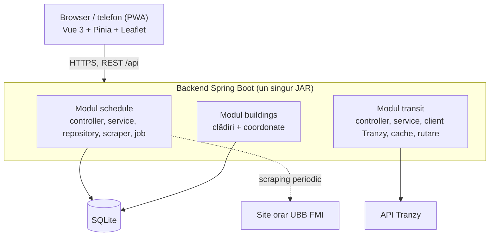

# Arhitectură

> Scopul, funcționalitățile, planul și stack-ul sunt în [README.md](../README.md). Acest document descrie doar arhitectura aplicației.

## 1. Stilul arhitectural

**Monolit modular + frontend separat (client-server, REST/JSON).**

- Un singur backend Spring Boot, împărțit în module cu responsabilități clare
- Un singur frontend Vue (PWA), care comunică cu backend-ul exclusiv prin `/api`
- Fără microservicii: un singur artefact de backend, un singur deploy

## 2. Diagrama



## 3. Componente

### Frontend (Vue 3 + Pinia + Leaflet)
- Single Page Application, instalabilă ca PWA
- Structură: `views/` (Orar, Hartă), `components/`, `stores/` (Pinia), `api/` (clienți HTTP), `styles/`
- Nu apelează servicii externe, doar backend-ul propriu
- Harta: Leaflet cu tile-uri OpenStreetMap

### Backend (Spring Boot)
Pe straturi în fiecare modul: **controller → service → repository** (sau client extern).

| Modul | Responsabilitate |
|---|---|
| `schedule` | Scraping și parsare orar, stocare, expunere orar pe grupă. Include jobul programat de reîmprospătare |
| `transit` | Proxy către Tranzy (stații, linii, vehicule, sosiri), cache, rutare |
| `buildings` | Clădirile cu coordonate, folosite de rutare |
| `config` | CORS, cache, scheduler, proprietăți |

Regulă între module: un modul folosește doar service-ul altui modul, niciodată repository-ul lui.

### Date
- **SQLite** pentru orar și clădiri
- Datele de transport nu se stochează, vin de la Tranzy și se țin doar în cache
- Un snapshot JSON al orarului stă în `backend/src/main/resources/seed/` și se încarcă dacă baza e goală

### Surse externe
- **Tranzy API:** date de transport
- **Site-ul UBB FMI:** sursa orarului (HTML)
- **Serviciu de rutare** (OSRM / OpenRouteService): doar dacă Tranzy nu oferă rutare (decizie după spike)

## 4. Fluxuri de date

**Orar**
```
Job programat → descarcă paginile UBB → parsare (Jsoup) → SQLite
Vue → GET /api/schedule → service → repository → răspuns
```

**Transport**
```
Vue → GET /api/transit/* → service → cache → (dacă lipsește) Tranzy → răspuns
```

**Rută spre o clădire**
```
Vue (locația utilizatorului + clădire) → transit service → buildings service (coordonate)
→ Tranzy / serviciu de rutare → traseu + timp estimat → Vue
```

## 5. Decizii arhitecturale

| Decizie | Motiv |
|---|---|
| Monolit modular, nu microservicii | Un singur deploy, fără complexitate de rețea; modulele pot fi separate ulterior |
| Frontend separat de backend, contract REST | Echipele lucrează în paralel; frontend-ul poate folosi date mock |
| Apelurile către Tranzy doar din backend | Cheia API rămâne pe server; se poate adăuga cache |
| Scraping offline (job programat), nu la fiecare request | Aplicația nu depinde de disponibilitatea site-ului UBB |
| Aplicația citește orarul doar din DB | Răspunsuri rapide, comportament stabil |
| Cache în memorie (Caffeine) | Protejează limitele Tranzy, fără infrastructură în plus |
| Poziții vehicule prin polling (10-15 s) | Simplu și suficient; fără WebSocket |
| SQLite | Date citite des și scrise rar, fără server de DB |
| PWA | Un singur cod pentru desktop și telefon, fără app store |
| Leaflet + OpenStreetMap | Gratuit, fără cheie API |

## 6. Contract API

Detaliile complete sunt în `docs/api.md`.

| Endpoint | Modul |
|---|---|
| `GET /api/health` | config |
| `GET /api/groups?specialization=&year=` | schedule |
| `GET /api/schedule?group={id}` | schedule |
| `GET /api/transit/stops` | transit |
| `GET /api/transit/routes` | transit |
| `GET /api/transit/vehicles` | transit |
| rută spre clădire (TODO: definit după spike Tranzy) | transit |

## 7. Structura repo-ului

```
student-assist/
├── backend/
│   └── src/main/java/ro/studentassist/
│       ├── schedule/
│       ├── transit/
│       ├── buildings/
│       └── config/
├── frontend/
│   └── src/ (views, components, stores, api, styles)
├── docs/
└── README.md
```