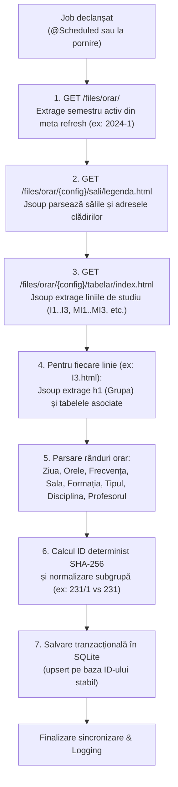

# Spike: Scraper Orar UBB FMI & Schema JSON

> **Autor:** Echipa Student Assist (Responsabil Scraper Orar)  
> **Status:** Finalizat / Decizie aprobată  
> **Data:** Noiembrie 2026  
> **Referință GitHub analizată:** [SemenciucCosmin/Orar-UBB-FMI](https://github.com/SemenciucCosmin/Orar-UBB-FMI)  
> **Fișiere livrate:** `docs/scraper-spike.md`, `docs/schedule-schema.json`, `backend/src/main/resources/seed/schedule-seed.json`

---

## 1. Rezumat executiv & Scopul Spike-ului

Acest document reprezintă analiza tehnică premergătoare implementării modulului `schedule` din cadrul aplicației **Student Assist**, răspunzând la cerințele din [README.md](../README.md) și [architecture.md](architecture.md).

### Obiectivele cercetării:
1. **Analiza proiectului open-source existent:** Cum a rezolvat proiectul [Orar-UBB-FMI](https://github.com/SemenciucCosmin/Orar-UBB-FMI) problema extragerii orarului de la Facultatea de Matematică și Informatică (UBB Cluj).
2. **Analiza formatului paginilor oficiale UBB FMI:** Cartografierea structurii HTML, URL-urilor, codării caracterelor și particularităților tabelelor.
3. **Decizie tehnică argumentată:** Alegerea justificată între **Reutilizăm**, **Adaptăm** sau **Rescriem**.
4. **Definirea Schemei JSON a orarului:** Standardizarea formatului datelor ([schedule-schema.json](schedule-schema.json)) pentru stocare internă, fișiere de seed offline și expunerea prin API REST către frontend-ul Vue.
5. **Ghid de implementare pentru echipa de backend:** Structura modulelor Spring Boot, biblioteca de parsare recomandată, algoritmul de sincronizare și strategia de fallback.

---

## 2. Analiza proiectului de referință (`SemenciucCosmin/Orar-UBB-FMI`)

Proiectul de pe GitHub reprezintă o aplicație client-side multiplatformă (Android + iOS + Desktop) construită în Kotlin.

### 2.1. Stack tehnologic & Arhitectură
* **Limbaj:** Kotlin (Kotlin Multiplatform - KMP).
* **UI:** Jetpack Compose Multiplatform.
* **Client HTTP:** Ktor Client (`cio` engine).
* **Persistență locală:** SQLDelight / Android Room.
* **Arhitectură:** Clean Architecture multi-modul pe client (`data/`, `domain/`, `feature/`, `ui/`).
  * `data:network`: serviciile API (`StudentsApi.kt`, `RoomsApi.kt`, `TeachersApi.kt`, `SubjectsApi.kt`).
  * `data:timetable`: sursa de date pentru evenimente (`EventsDataSourceImpl.kt`).
  * `data:groups`: preluarea grupelor și a orarelor pe grupă (`GroupsDataSourceImpl.kt`).
  * `data:rooms`: preluarea sălilor și a legendei (`RoomsDataSourceImpl.kt`).
  * `domain:html-parser`: utilitarul de parsare manuală a string-urilor HTML (`HtmlTableParser.kt`).

### 2.2. Cum realizează extragerea datelor
1. **URL de bază:** `https://www.cs.ubbcluj.ro/files/orar`
2. **Puncte de acces (Endpoints HTML):**
   * Indexul liniilor de studiu: `$BASE_URL/{year}-{semester}/tabelar/index.html`
   * Orarul unei linii de studiu: `$BASE_URL/{year}-{semester}/tabelar/{studyLineId}.html` (ex: `I3.html`, `M1.html`)
   * Legenda sălilor (nume + adresă): `$BASE_URL/{year}-{semester}/sali/legenda.html`
   * Orarul unei săli: `$BASE_URL/{year}-{semester}/sali/{roomId}.html`
   * Profesori: `$BASE_URL/{year}-{semester}/cadre/index.html` și `{teacherId}.html`
   * Materii: `$BASE_URL/{year}-{semester}/disc/index.html` și `{subjectId}.html`

3. **Mecanismul de parsare HTML (`HtmlTableParser.kt`):**
   * Nu utilizează o bibliotecă dedicată de parsare DOM (precum Jsoup).
   * Utilizează **căutare manuală prin slice-uri de text** pe string-ul brut (`html.indexOf(openTag)`, `html.substring(...)`):
     * Titluri de grupă/pagină: căutare între `<h1` și `</h1`.
     * Rânduri de tabel: căutare între `<tr` și `</tr`.
     * Celule de tabel: căutare între `<td` și `</td`.
     * Extragere linkuri: căutare după `f="` (href) și `" >`.
     * Caractere `&nbsp;` mapate la `null`.

4. **Identificarea unică a evenimentelor (Hashing determinist):**
   În `GroupsDataSourceImpl.kt`, fiecare rând de orar primește un ID stabil calculat prin SHA-256 peste atributele sale cheie:
   ```kotlin
   val id = listOf(
       dayCell.value,
       intervalCell.value,
       frequencyCell.value,
       roomCell.id,
       group.name,
       participantCell.value,
       eventTypeCell.value,
       group.id,
       groupCell.id,
       teacherCell.id
   ).joinToString("|").encodeUtf8().sha256().hex()
   ```

### 2.3. Puncte forte identificate
* **Înțelegere excelentă a structurii UBB FMI:** A identificat corect toate convențiile de denumire a fișierelor HTML pe serverul UBB.
* **Descoperirea legendei sălilor (`sali/legenda.html`):** Este o resursă esențială pentru Student Assist, deoarece conține adresele reale ale clădirilor din Cluj, permițând modulului `buildings` să asocieze coordonate geografice pentru hartă.
* **Modelare curată a orelor:** Separare pe zile, intervale, frecvență (`sapt. 1`, `sapt. 2`, ambele) și formații de studiu (grupă vs subgrupă).
* **ID determinist SHA-256:** Asigură deduplicarea facilă a evenimentelor și permite actualizări idempotente în baza de date.

### 2.4. Puncte slabe, limitări și riscuri critice
1. **Parsare manuală prin string slicing extrem de fragilă:**
   * Căutarea prin string-uri literale (ex: `f="` și `" >"`) eșuează imediat dacă pe site-ul UBB dispare spațiul dinaintea lui `>` (ex: `href="foo">`), dacă atributele sunt ordonate diferit sau dacă apar ghilimele simple.
   * În caz de HTML malformat sau comentarii HTML, parsarea produce date corupte sau excepții de indexare (`StringIndexOutOfBoundsException`).
2. **Incompatibilitate tehnologică cu backend-ul nostru:**
   * Proiectul de referință este scris în Kotlin pentru dispozitive mobile (KMP/Compose).
   * Backend-ul aplicației noastre este un monolit modular în **Java 17 + Spring Boot 4** ([architecture.md](architecture.md)).
3. **Arhitectură eronată pentru o aplicație web (Scraping pe client vs Scraping centralizat pe backend):**
   * Aplicația de pe GitHub descarcă zeci de pagini HTML direct de pe dispozitivul fiecărui student. La 1.000 de studenți deschizând aplicația, serverul facultății primește zeci de mii de cereri redundante, riscând blocarea IP-urilor utilizatorilor prin rate-limiting.
   * Conform deciziei din [architecture.md](architecture.md), scraping-ul trebuie să se execute centralizat pe backend (job programat noaptea), datele se salvează în SQLite, iar frontend-ul le citește rapid via `/api/schedule`.
4. **Problema codării caracterelor (Encoding `ISO-8859-2`):**
   * Paginile UBB FMI declară `<META HTTP-EQUIV="Content-Type" CONTENT="text/html; charset=ISO-8859-2">`.
   * Diacriticele românești (ș, ț, ă, î, â) vor apărea complet corupte (`?`, ``) dacă răspunsul HTTP este citit nativ ca UTF-8 fără conversie explicită. Proiectul de referință are deficiențe la acest capitol.
5. **Absența detecției dinamice a semestrului curent:**
   * În codul de referință, anul și semestrul erau setate manual sau prin preferințe hardcodate. Rădăcina UBB conține un meta-refresh automat către semestrul activ, ce poate fi exploatat pentru zero-configurare.

---

## 3. Analiza formatului orarului UBB FMI

Analiza directă a paginilor active de pe `https://www.cs.ubbcluj.ro/files/orar/` relevă următoarea structură:

### 3.1. Rădăcina și detecția automată a semestrului
Accesarea URL-ului `https://www.cs.ubbcluj.ro/files/orar/` întoarce:
```html
<meta http-equiv="refresh" content="3; URL=2025-1" />
```
Această etichetă permite backend-ului nostru să descopere automat configurația semestrială activă (ex: `2024-1`, `2025-1`) la runtime, fără reconfigurări manuale la fiecare început de semestru.

### 3.2. Indexul liniilor de studiu (`tabelar/index.html`)
Conține tabele împărțite pe cicluri de studii:
* **Studii Licență:** Linii de studiu în Română, Engleză, Maghiară, Germană (ex: `I1.html`, `I2.html`, `I3.html`, `MI1.html`, `IE1.html`, `IG1.html`).
* **Studii Masterat:** Programe de masterat (ex: `MaBD1.html`, `MaSD1.html`, `MaIS1.html`, `Cyber1.html`).

Fiecare celulă leagă denumirea liniei de studiu și anul corespunzător la fișierul HTML dedicat.

### 3.3. Structura paginii de orar a unei linii de studiu (ex: `I3.html`)
Fișierul HTML agregă orarele pentru **toate grupele** acelei specializări, separate prin antete `<h1>`:
```html
<h1>Orar Anul 3 Informatica - linia de studiu romana</h1>
<h1>Grupa 231</h1>
<table border=1 cellspacing=0 cellpadding=0>
  <tr align=center>
    <th>Ziua</th>
    <th>Orele</th>
    <th>Frecventa</th>
    <th>Sala</th>
    <th>Formatia</th>
    <th>Tipul</th>
    <th>Disciplina</th>
    <th>Cadrul didactic</th>
  </tr>
  <tr align=center>
    <td>Luni</td>
    <td class="bloc">8-10</td>
    <td>&nbsp;</td>
    <td><a href="../sali/7-I.html" >7/I</a></td>
    <td>231</td>
    <td>Seminar</td>
    <td><a href="../disc/MLR5023.html" >Limbaje formale si tehnici de compilare</a></td>
    <td><a href="../cadre/poio1.html" >Drd. POP Ioan Daniel</a></td>
  </tr>
  ...
</table>
<h1>Grupa 232</h1>
<table ...>...</table>
```

### 3.4. Reguli specifice ale datelor din tabel
| Coloană | Valori posibile | Interpretare & Normalizare |
|---|---|---|
| **Ziua** | Luni, Marti, Miercuri, Joi, Vineri | Mapare directă către `DayOfWeek` (index 1..5). |
| **Orele** | `8-10`, `10-12`, `12-14`, dar și `12-15`, `16-19` | Interval start-end. Se extrag `startHour` și `endHour`. Atenție: unele activități au durată de 3 ore! |
| **Frecvența** | `&nbsp;`, `sapt. 1`, `sapt. 2` | `&nbsp;` înseamnă **săptămânal** (`all`). `sapt. 1` = săptămână impară, `sapt. 2` = săptămână pară. |
| **Sala** | `<a href="../sali/7-I.html">7/I</a>` | Se extrage `id` (`7-I`) și eticheta `name` (`7/I`). |
| **Formația** | `231`, `231/1`, `231/2`, `I3` | Dacă este identică cu grupa (`231`), este pentru toată grupa. Dacă conține slash (`231/1`), este pentru subgrupă. Dacă este codul anului (`I3`), este oră comună întregului an (curs). |
| **Tipul** | `Curs`, `Seminar`, `Laborator` | Enum standard: `EventType`. |
| **Disciplina** | `<a href="../disc/MLR5023.html">Nume materie</a>` | Se extrage codul materiei (`MLR5023`) și denumirea completă. |
| **Cadrul didactic** | `<a href="../cadre/poio1.html">Titlu Nume</a>` | Se extrage codul cadrului didactic (`poio1`) și numele complet. |

### 3.5. Legenda sălilor (`sali/legenda.html`)
Fișierul `sali/legenda.html` conține tabelul de corelare între codul fiecărei săli și clădirea fizică:
```html
<tr>
  <td align=center><a href="7-I.html" >7/I</a></td>
  <td align=left>Sala D.V. Ionescu, Cladirea Centrala, etaj 1 (Str. M. Kogalniceanu)</td>
</tr>
<tr>
  <td align=center><a href="C335.html" >C335</a></td>
  <td align=left>Laborator FSEGA, Campus FSEGA, str. Teodor Mihali, nr. 56-60</td>
</tr>
```
Această tabelă este puntea de legătură directă cu modulul **`buildings`** din `architecture.md`, permițând asocierea fiecărei ore de curs cu clădirea și coordonatele GPS necesare pentru modulul de transport (rutare Tranzy).

---

## 4. Evaluare comparativă: Reutilizăm vs Adaptăm vs Rescriem

| Criteriu de evaluare | Opțiunea 1: Reutilizăm codul | Opțiunea 2: Adaptăm conceptele & Rescriem implementarea | Opțiunea 3: Rescriem de la zero fără a analiza referința |
|---|---|---|---|
| **Compatibilitate cu backend-ul** | ❌ **Eșec:** Kotlin Multiplatform / Ktor nu se potrivesc nativ în monolit Spring Boot Java 17. | ✅ **Excelent:** Implementare în Java 17 cu Jsoup, integrată curat în `ro.studentassist.schedule`. | ⚠️ **Riscant:** Necesită efort duplicat și timp mare de explorare. |
| **Robustețea parsării** | ❌ **Fragilă:** Căutarea manuală de string-uri din `HtmlTableParser` este predispusă la erori la orice schimbare HTML. | ✅ **Maximă:** Utilizarea Jsoup (DOM parser de nivel industrie, selectori CSS, toleranță la erori HTML). | ✅ Posibilă dacă se alege Jsoup. |
| **Tratarea caracterelor (Encoding)** | ❌ Probleme cu ISO-8859-2 pe client. | ✅ Suport nativ complet pentru ISO-8859-2 în clientul Java HTTP / Jsoup. | ⚠️ Risc ridicat de a omite problema codării fără analiza anterioară. |
| **Performanță & Rețea** | ❌ Scraping pe telefonul fiecărui student (abuz de rețea, risc ban IP). | ✅ Scraping centralizat pe server (cron job) + salvare SQLite + servire instantanee prin REST API. | ✅ Dacă e plasat pe backend. |
| **Reutilizarea know-how-ului valoros** | ⚠️ Nu profită de punctele forte ale modelării backend. | ✅ **Preia convențiile validate:** URL-urile UBB, schema entităților, legenda sălilor și ID-ul SHA-256. | ❌ Pierde avantajul experienței acumulate în proiectul de referință. |
| **Cost de mentenanță** | ❌ Imens (două ecosisteme diferite). | ✅ **Minim:** Cod Java curat, modular, aliniat cu Spring Modulith. | ⚠️ Mediu. |

---

## 5. Decizie Asumată

> ### [!IMPORTANT]
> **DECIZIE FORMALĂ: ADAPTĂM & RESCRIEM**
> 
> 1. **ADAPTĂM:**
>    * Modelul de date și vocabularul de domeniu (Specializare, An, Grupă, Subgrupă, Tip activitate, Frecvență).
>    * Maparea URL-urilor de pe `cs.ubbcluj.ro` (`tabelar/index.html`, `{studyLine}.html`, `sali/legenda.html`).
>    * Algoritmul de hashing determinist (SHA-256) pentru ID-ul unic al evenimentelor de orar.
>    * Extragerea metadatelor de localizare a sălilor pentru a hrăni modulul `buildings`.
> 
> 2. **RESCRIEM COMPLET:**
>    * Parsarea HTML: renunțăm la string slicing manual și folosim **Jsoup (Java)** cu selectori CSS și arbore DOM.
>    * Tehnologia: implementăm serviciul pe server în **Java 17 + Spring Boot 4**, conform arhitecturii din [architecture.md](architecture.md).
>    * Modul de execuție: scraping-ul devine un proces centralizat de fundal (**Spring Scheduled Job**), rulat periodic (ex: noaptea) și stocat în **SQLite**.
>    * Gestionarea codării: decodare forțată cu charset **ISO-8859-2** la citirea răspunsurilor HTML de la UBB.
>    * Modul Offline / Seed: generarea unui fișier `schedule-seed.json` încărcat la pornirea aplicației dacă baza SQLite este goală, garantând că aplicația funcționează complet offline chiar și la un demo fără internet.

---

## 6. Ghid de implementare pentru echipa de Backend

Pentru colegii care vor scrie codul în `backend/src/main/java/ro/studentassist/schedule/`, mai jos se află specificația exactă de implementare.

### 6.1. Dependință Gradle necesară
În `backend/build.gradle` trebuie adăugată biblioteca Jsoup:
```groovy
dependencies {
    // Parser HTML robust pentru scraping UBB FMI
    implementation 'org.jsoup:jsoup:1.18.3'
    ...
}
```

### 6.2. Structura pachetului `ro.studentassist.schedule`
Respectând structura din [architecture.md](architecture.md), codul se organizează pe straturi:
```
ro.studentassist.schedule/
├── client/
│   └── UbbScheduleClient.java         // Client HTTP dedicat UBB (descarcă paginile cu charset ISO-8859-2)
├── scraper/
│   ├── UbbScheduleScraper.java        // Parsare DOM cu Jsoup (index, linii de studiu, grupe, ore)
│   └── UbbRoomsScraper.java           // Parsare legenda sălilor (adrese clădiri)
├── job/
│   └── ScheduleSyncJob.java           // Job programat (@Scheduled) pentru reîmprospătare orar
├── entity/
│   ├── SpecializationEntity.java      // Tabel SQLite: specializari / linii de studiu
│   ├── GroupEntity.java               // Tabel SQLite: grupe academice
│   ├── RoomEntity.java                // Tabel SQLite: săli și locații
│   └── ScheduleEventEntity.java       // Tabel SQLite: sloturi de orar (curs/seminar/lab)
├── repository/
│   ├── SpecializationRepository.java
│   ├── GroupRepository.java
│   ├── RoomRepository.java
│   └── ScheduleEventRepository.java
├── service/
│   ├── ScheduleService.java           // Interfață publică pentru alte module
│   └── ScheduleServiceImpl.java       // Logică de business, interogări, încărcare seed
├── controller/
│   └── ScheduleController.java        // Expune /api/groups și /api/schedule
└── dto/
    ├── GroupDto.java
    ├── ScheduleResponseDto.java
    └── ScheduleEventDto.java
```

### 6.3. Pipeline-ul de scraping și ingestie pas cu pas



#### Cod demonstrativ pentru parsare Jsoup cu decodare corectă:
```java
// Exemplu citire cu charset ISO-8859-2
String baseUrl = "https://www.cs.ubbcluj.ro/files/orar/2024-1/tabelar/I3.html";
Document doc = Jsoup.connect(baseUrl)
        .userAgent("StudentAssist/1.0 (UBB FMI Student Assistant)")
        .timeout(15000)
        .parser(Parser.htmlParser())
        .get();

// Jsoup detectează charset-ul din <meta> sau se forțează ISO-8859-2:
// doc.charset(Charset.forName("ISO-8859-2"));

Elements h1Elements = doc.select("h1");
for (Element h1 : h1Elements) {
    String text = h1.text().trim();
    if (text.startsWith("Grupa")) {
        String groupId = text.replace("Grupa", "").trim();
        Element table = h1.nextElementSibling();
        if (table != null && table.tagName().equals("table")) {
            Elements rows = table.select("tr");
            for (Element row : rows) {
                Elements cells = row.select("td");
                if (cells.size() >= 8) {
                    String day = cells.get(0).text().trim();
                    String hours = cells.get(1).text().trim();
                    String frequency = cells.get(2).text().trim();
                    Element roomAnchor = cells.get(3).selectFirst("a");
                    String formation = cells.get(4).text().trim();
                    String type = cells.get(5).text().trim();
                    Element subjectAnchor = cells.get(6).selectFirst("a");
                    Element teacherAnchor = cells.get(7).selectFirst("a");

                    // Construire și salvare ScheduleEventEntity
                }
            }
        }
    }
}
```

### 6.4. Strategia de Seed & Fallback Offline
Conform `architecture.md` (Secțiunea 3: *"Un snapshot JSON al orarului stă în backend/src/main/resources/seed/ și se încarcă dacă baza e goală"*):
* A fost creat fișierul `backend/src/main/resources/seed/schedule-seed.json`.
* La pornirea aplicației Spring Boot, o componentă `ApplicationRunner` sau `CommandLineRunner` verifică:
  ```java
  if (scheduleEventRepository.count() == 0) {
      log.info("Baza de date SQLite este goală. Se încarcă seed-ul inițial din schedule-seed.json...");
      scheduleService.loadSeedData("seed/schedule-seed.json");
  }
  ```
* Acest mecanism oferă 100% rezistență: dacă site-ul UBB este indisponibil sau dacă se dă un demo fără acces la rețea, aplicația funcționează perfect cu orarul seed-at.

### 6.5. Integrarea cu modulul `buildings`
Modulul `buildings` este responsabil pentru clădiri și coordonate GPS ([architecture.md](architecture.md)).
* Scraper-ul din `schedule` extrage din `sali/legenda.html` adresele brute și denumirile clădirilor (ex: *"Campus FSEGA, str. Teodor Mihali, nr. 56-60"*).
* Modulul `buildings` asociază fiecărei clădiri cunoscute o pereche de coordonate `(latitude, longitude)`.
* Când utilizatorul dorește să afle ruta spre următoarea oră, frontend-ul apelează modulul `transit`, care preia coordonatele clădirii din `buildings` pe baza sălii extrase de `schedule`.

### 6.6. Alinierea cu Contractul API REST
Endpoint-urile definite în `architecture.md` vor respecta următoarea convenție:

#### 1. `GET /api/groups?specialization={id}&year={year}`
Returnează lista de grupe disponibile pentru selecție în frontend:
```json
[
  {
    "id": "231",
    "name": "Grupa 231",
    "specializationId": "I3",
    "year": 3,
    "subgroups": ["231/1", "231/2"]
  }
]
```

#### 2. `GET /api/schedule?group={id}`
Returnează orarul complet al grupei selectate (inclusiv orele comune de curs și cele de laborator pe subgrupe):
```json
{
  "group": {
    "id": "231",
    "name": "Grupa 231",
    "specializationId": "I3",
    "year": 3,
    "subgroups": ["231/1", "231/2"]
  },
  "specialization": {
    "id": "I3",
    "name": "Informatică - linia de studiu română",
    "field": "Informatica",
    "language": "romana",
    "degree": "licenta",
    "year": 3
  },
  "totalEvents": 42,
  "events": [
    {
      "id": "4a78e8c617b7a4e69b0faee23bb0d087b7a66f076b92a4e21a206fb4119d5543",
      "groupId": "231",
      "subgroup": null,
      "formation": "231",
      "day": "Luni",
      "dayIndex": 1,
      "startHour": 8,
      "endHour": 10,
      "startTime": "08:00",
      "endTime": "10:00",
      "frequency": "all",
      "frequencyLabel": "săptămânal",
      "type": "Seminar",
      "subject": {
        "id": "MLR5023",
        "name": "Limbaje formale si tehnici de compilare"
      },
      "teacher": {
        "id": "poio1",
        "name": "Drd. POP Ioan Daniel"
      },
      "room": {
        "id": "7-I",
        "name": "7/I",
        "buildingName": "Clădirea Centrală UBB",
        "address": "Str. Mihail Kogălniceanu, nr. 1"
      }
    }
  ]
}
```

---

## 7. Schema JSON Oficială

Schema completă de validare se află în fișierul [docs/schedule-schema.json](schedule-schema.json). Ea descrie:
1. `Metadata`: meta-informații despre semestru, anul universitar și data extracției.
2. `Specialization`: linii de studiu, ciclu universitar (licență/master) și limbă de predare.
3. `Group`: grupe și subgrupe.
4. `Room`: cod sală, denumire, clădire și adresă fizică din Cluj.
5. `Teacher`: cod și nume complet al cadrului didactic.
6. `Subject`: cod și denumire disciplină.
7. `ScheduleEvent`: eveniment de orar complet cu ID hash SHA-256, interval orar, frecvență și asocieri de sală/materie/profesor.
8. `ApiScheduleResponse` și `ApiGroupsResponse`: specificația payload-ului JSON livrat frontend-ului.

---

## 8. Concluzii și pași următori

* **Stadiu curent:** Analiza spike-ului și a contractelor JSON este finalizată cu succes.
* **Următoarele task-uri recomandate pentru echipa de backend:**
  1. Adăugarea dependinței Jsoup în `backend/build.gradle`.
  2. Implementarea entităților JPA în `ro.studentassist.schedule.entity` corespunzătoare tabelelor SQLite.
  3. Implementarea `ScheduleDataLoader` pentru încărcarea automată la startup a fișierului `schedule-seed.json`.
  4. Implementarea serviciului `UbbScheduleScraper` cu Jsoup și configurarea jobului `@Scheduled` pentru sincronizarea automată.
  5. Expunerea endpoint-urilor REST în `ScheduleController` și validarea lor prin teste de integrare Spring Boot.
